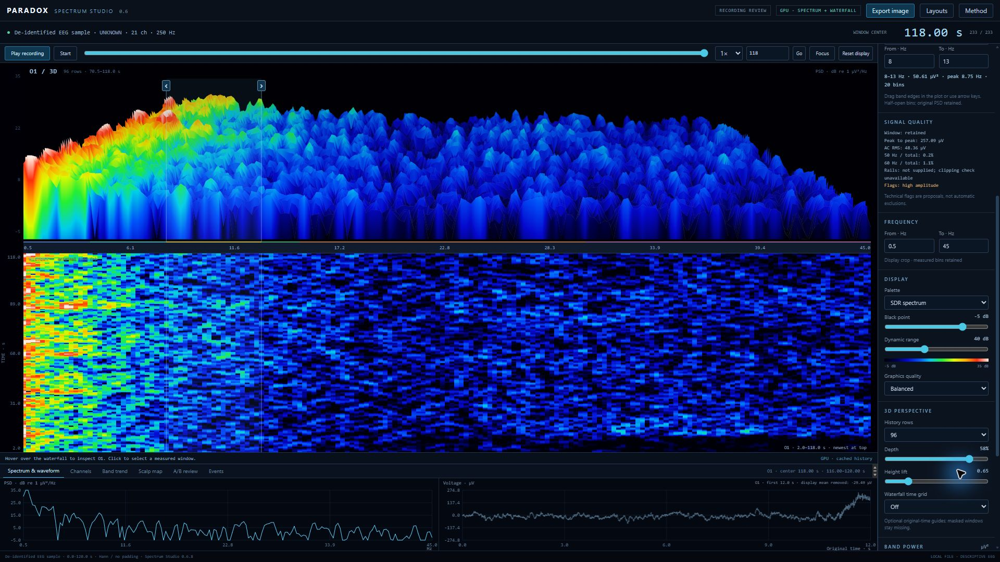
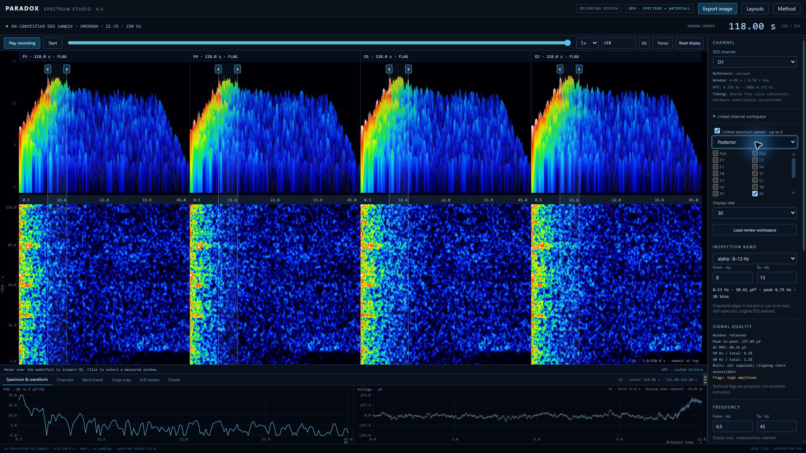
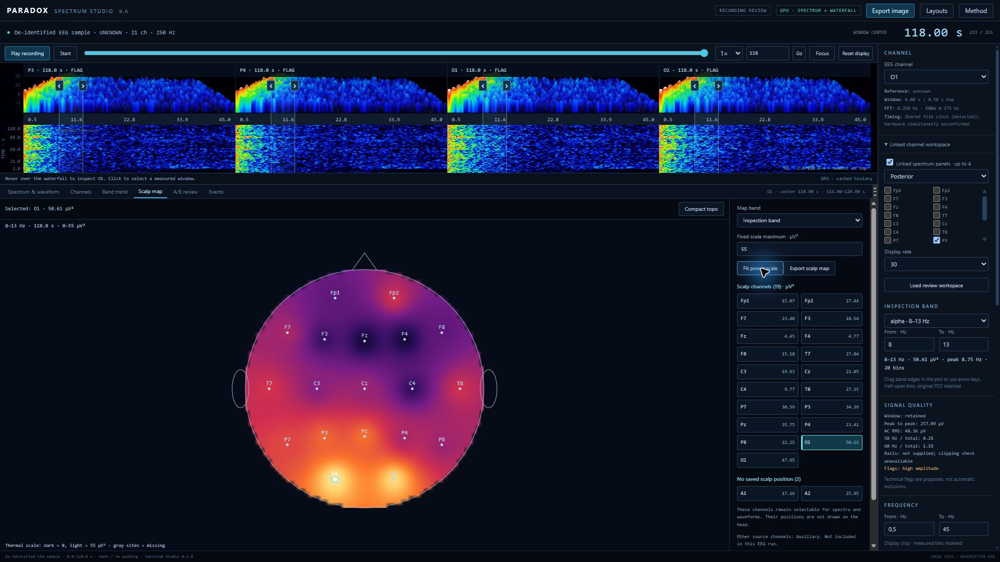
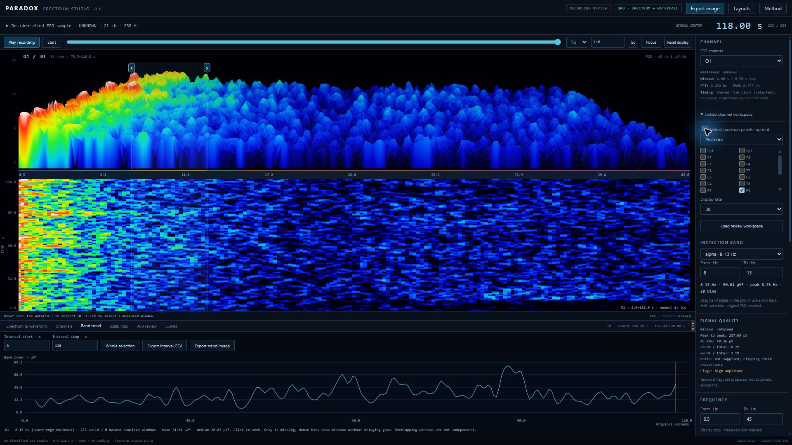

# EEG Paradox — Spectrum Studio

I've been working on another part of EEG Paradox, called **Spectrum Studio**.

This started with me looking at the spectrum and waterfall displays in SDR software and thinking, “I'd really like to look through an EEG recording like that.” AetherSDR was the starting point for the visual approach. From there, I've been building the file loading, measurements and review tools around EEG.

You open a recording, choose your channels, and move through it while watching the frequency content change. When something catches your eye, you can pause, slow it down, move back through it, or bring another channel alongside it. That's the part I wanted: being able to spend time exploring a recording and taking a closer look at the interesting bits.

It also makes the images, reports and data exports you need afterwards, so the review doesn't end with a screenshot you can't trace back to anything.

**Current app version: 0.6.8.** On Windows, the app is one file: [Spectrum Studio.exe from the 0.6.8 release](https://github.com/ElChaderino/EEG-Paradox-Spectrum-Studio/releases/tag/v0.6.8). That's all you need to download and run. The source is here if you want to look through it, build it, or work on the tools.

## A look at it

These screenshots use real EEG with identifying labels, filenames, dates and local paths removed. The original recordings are not included in this repository.









## Getting it running

If you just want to use the app, download [Spectrum Studio.exe](https://github.com/ElChaderino/EEG-Paradox-Spectrum-Studio/releases/download/v0.6.8/Spectrum%20Studio.exe) from the [0.6.8 release](https://github.com/ElChaderino/EEG-Paradox-Spectrum-Studio/releases/tag/v0.6.8). The Windows file version on that build is **0.6.8.2**.

You only need that one EXE. There's no installer, no separate Python setup, and you don't need the rest of EEG Paradox installed. It has its own app icon and opens the recording loader when you double-click it.

GitHub also puts **Source code (zip)** and **Source code (tar.gz)** under releases automatically. Those are for people working on the code. They are not the Windows application, and you don't need either of them to run the EXE.

The current Windows build is for **64-bit Windows**. The interactive viewer opens in your installed browser. A browser with WebGL2 gives you the GPU display; the viewer has a labelled CPU fallback when that isn't available. Performance depends on the machine, browser, number of channels and display settings.

The first launch can take a little longer while the single-file runtime starts. Settings and default outputs live under `%LOCALAPPDATA%\EEG Paradox\Spectrum Studio`. You can choose a different output folder in the app. Moving the EXE doesn't move or reset your saved runs.

## Opening your first recording

1. Open **Spectrum Studio.exe** and choose **Browse recordings…**.
2. Select your recording. You can choose more than one file for a batch; each gets its own separate run.
3. Use **Inspect first file…** if you want to check the duration, sampling rate, channel names, units and likely storage requirements before running it. You can select the EEG channels there too.
4. Pick the section you want to look at. The default is the first **120 seconds**, with a **4-second FFT window** and **0.5-second hop**. Change the start and duration, or choose **Whole recording**.
5. Leave timing on **auto** unless you have acquisition information that justifies an override. Supply the documented reference if you know it. Choose a recording condition such as EC or EO yourself; an unknown condition stays unknown.
6. Choose an output folder, then click **Run recording + reports**.
7. When it's finished, use **Open viewer**, **Open report** or **Output folder** under **Runs & outputs**.

Long recordings and small hops can create a lot of spectral data. The inspection estimate helps you judge that before processing. If a selection exceeds the app's data limit, reduce its length, choose fewer channels or increase the hop. The app doesn't quietly throw away windows to make it fit.

The loader keeps the completed runs available, including separate results from a batch. It also remembers recent runs and can open a completed run folder later. Reopening a saved viewer doesn't mean processing the original recording again.

## Files it supports

The normal recording readers cover:

- **EDF / EDF+** — `.edf`
- **BDF / BDF+** — `.bdf`
- **MNE FIF** — `.fif` and `.fif.gz`
- **GDF** — `.gdf`
- **BrainVision** — choose the `.vhdr` header and keep its `.eeg` and `.vmrk` companions with it
- **Neuroscan CNT** — `.cnt`
- **EEGLAB SET** — `.set`, with its `.fdt` companion when the recording uses one
- **Native WinEEG EEG** — `.eeg`, through the maintained WinEEG intake and conversion audit
- **BioExplorer BXS** — `.bxs`, through the BXS conversion path
- **Calibrated signal files** — `.csv`, `.tsv`, `.json` and `.npz`

An extension is only part of the story. A valid supported recording still needs readable samples, a known sampling rate and usable calibration. A random file renamed to one of these extensions won't become an EEG recording.

**About `.eeg`:** BrainVision also uses that extension for a companion signal file. Open a BrainVision recording through its `.vhdr`, rather than selecting the companion `.eeg` on its own. The standalone `.eeg` route here is for the supported native WinEEG binary format.

Names such as EC, EO or a person's initials are recording labels, not extra file formats. A file called `example_EC.edf` is still an EDF.

### CSV, TSV, JSON and NPZ

CSV and TSV files have samples in rows and channel names in the header. They can include a regular `time` or `time_seconds` column. Choose the calibrated voltage unit and sampling rate when the file doesn't supply them. Irregular time columns are refused; gaps should remain explicit, rather than being squeezed out of the recording.

Signal JSON and NPZ use channels-by-samples `data`, along with `channels`, `sfreq` and `unit`. They can also carry a starting time, annotations and explicit timing/layout metadata. NPZ loading does not enable pickle.

These are calibrated signal inputs. A spreadsheet of already calculated band powers, z-scores or summary results isn't a substitute for the underlying time-series samples.

### Native conversion

WinEEG and BXS conversions are kept inside the new run's `intake` folder with their audit information. The original recording stays in place. The app checks the conversion rather than guessing missing calibration.

WinEEG intake retains the original integer samples and calibration separately. Its range-adaptive EDF export uses 16-bit quantization, and the resulting quantization error is measured and reported. It isn't described as a bit-for-bit copy of the native file.

The Windows build includes the required intake code. When working from source, keep the intake packages and the maintained converter included in this repository together; copying only the viewer folder won't provide those bridges.

## Looking through a recording

### 3D spectrum history and waterfall

The upper display shows a history of the channel's spectra as stacked ridges. Under it, the waterfall shows frequency across the screen and recording time down the screen. They follow the same selected channel, time and frequency range.

The colors and height describe power. You can change the black point, dynamic range, palette, depth, history length and height lift to make a particular recording easier to read. Those are display controls. Changing them doesn't rewrite the EEG or recalculate a different result behind the scenes.

Hover over the waterfall to inspect a measured cell. Click it to move to that window. The selected-window spectrum gives you a flat view of the same frequency content, alongside the waveform excerpt.

The raw waveform view is a labelled opening excerpt, up to the first 12 seconds of the selection. It isn't a scrolling trace of the entire recording. Its default display removes the excerpt's mean so a large DC offset doesn't flatten the visible fluctuations; the removed mean is shown, and you can switch back to the acquired values.

### Playback and moving around

Play, pause, change speed, move the slider, or enter a time in seconds and use **Go**. Playback follows the recording's own clock. You can also use:

- **Space** to play or pause.
- **Left / Right** to move one retained window.
- **Shift + Left / Right** to move ten windows.
- **Home / End** to jump to the first or last window.

The shortcuts leave text fields alone while you're editing them. Replay uses spectra already calculated from the file. This version doesn't connect directly to an EEG amplifier for live acquisition.

### Linked channels

Turn on **Linked spectrum panels** to show up to four channels together. Pick them yourself or use a Frontal, Posterior or Left/right preset when the corresponding labels exist.

Every panel shares the selected time, frequency range and power scale. That lets you compare what is happening across channels without a separate automatic color scale making them all look equally strong. The **Channels** tab also provides a shared-scale spectrum comparison for up to eight selected channels.

### Band inspection and trends

Choose a named EEG band or move the inspection edges to look at a range of your own. You can drag the handles, use their arrow keys, or enter the lower and upper frequencies directly.

The included bands are delta **0.5–4 Hz**, theta **4–8 Hz**, alpha **8–13 Hz**, SMR **12–15 Hz**, beta **15–30 Hz**, high beta **22–30 Hz**, and gamma **30–45 Hz**. SMR and high beta overlap the other bands; adding all these values together is not a total-power calculation.

**Band trend** shows the selected channel's inspection-band power over time. Choose an interval, inspect its measurements, click the trend to seek, and export an image or the per-window CSV. Only complete FFT windows inside the chosen interval contribute. An interval with no complete usable window explains that instead of producing a blank or misleading export.

### Scalp maps and all the channels

The scalp map shows band power at the saved electrode sites, with display interpolation between them. It follows the recording cursor and can use the inspection band or another available named band.

The app checks the recording for saved positions and timing evidence. Supported native files can carry an electrode layout and a shared file clock. Other formats may provide an embedded montage, or you can explicitly choose a standard 10–20 template when that is appropriate for your recording.

It doesn't invent electrode positions just because a label sounds familiar. A usable map needs time-alignment evidence and at least three valid, non-collinear scalp sites. If that information is missing, the app explains what it needs.

All retained EEG channels stay selectable. Channels with positions appear on the head and in the scalp channel list. Channels without a saved scalp position remain in a separate selectable list; they don't get pushed onto an invented location on the head. Auxiliary and synchronization channels are treated according to their file descriptors.

Use **Expand topo** for a larger map. **Fit power scale** sets the scale from the valid positioned channels in the selected window, then holds it fixed as you move through the recording. You can also set the scale yourself.

A saved schematic layout isn't measured head anatomy. A shared file clock doesn't, by itself, prove hardware simultaneity. This is a descriptive sensor-power display, with the available context shown alongside it.

### Quality, events and bookmarks

The quality readouts include peak-to-peak voltage, AC RMS, missing samples, overlap with BAD/EDGE annotations and 50/60 Hz power ratios. Flat, high-amplitude and line-noise flags are technical prompts to look more closely. They don't automatically delete data or decide whether a recording is clinically abnormal.

Clipping checks require calibrated hardware rail information. The numerical limits used to store an EDF aren't assumed to be the amplifier's real clipping limits.

Events and supplied annotations stay attached to original recording time. You can browse them, jump between them, add bookmarks and import/export event JSON. Proposed, accepted and rejected review items stay distinct. Overlaying an artifact decision doesn't silently change which samples were used for the spectra; changes to numerical exclusions need a regenerated analysis.

### A/B review

You can compare selected intervals, or use a compatible second recording. The review reports the windows included and the power differences, ratios and dB changes that can be calculated.

Mean spectra are averaged in linear power before conversion to dB. Different recordings need compatible bins, units, estimator settings and known matching references. An unknown reference isn't silently treated as a match. Conditions such as EC and EO remain supplied labels, and overlapping FFT windows aren't presented as independent observations.

### Workspaces and reusable layouts

A **review workspace** saves the recording's review state: cursor, channels, display settings, bands, intervals and events. It is tied to the retained recording data so it can't quietly be applied to a different file.

A **layout** saves the arrangement and display choices you want to reuse across recordings. Start from Single-channel review, Channel overview, Band-power review or Event review, or save your own named setup. You can import/export a layout library too. Browser storage support varies for local files, so exporting the library gives you a copy you can keep or move to another computer.

## Images, PDF reports and data exports

Running a recording creates a local report gallery, the interactive viewer and a collection of figures. Depending on the recording and the context available, these include:

- A spectrum/waterfall overview.
- Channel spectra and band-power summaries.
- Band-power timelines.
- Signal-quality figures.
- Each retained channel's waterfall and waveform excerpt.
- A scalp map, or a clear explanation of why a map isn't available.
- An A/B figure when a compatible comparison is supplied.

The run also produces **`Spectrum_Studio_Report.pdf`**, along with CSV/JSON summaries. The viewer has its own image, scalp-map, trend, event, workspace and comparison exports for the part of the review you're working on.

The main output folders are:

```text
your_run/
  OPEN_REPORT.html
  reports/
    Spectrum_Studio_Report.pdf
    channel_summary.csv
    summary.json
    ... PNG figures
  review/
    OPEN_SPECTRUM_STUDIO.html
    spectrum_arrays.npz
    band_power.csv
    method.json
    review_context.json
    spectrum_manifest.json
  run_manifest.json
  run_status.json
```

Native imports can also add an `intake` folder. The run inventory records file hashes, and the app checks completed runs before restoring them. Failed or cancelled processing is recorded as such, rather than being labelled a completed report.

## What stays local

Recording processing and the generated viewer run locally. The viewer doesn't require a web server, CDN, online account or remote analysis API. It doesn't automatically upload your EEG.

Your original files are left alone. Derived files, reports, conversions and settings go into the output/profile locations instead.

That doesn't make every export anonymous. A normal report, saved workspace, interactive HTML or method file can contain the recording label, events, provenance and signal data. Check what you're sharing. The screenshots in this README were prepared separately with identifying details removed; the original real EEG files and private completed runs are not distributed here.

## A little about the measurements

I want it to be clear what the displays actually mean, especially when the colors make them tempting to overinterpret.

The default calculation uses complete **4-second windows**, spaced **0.5 seconds** apart. Each window has its mean removed and uses a periodic Hann taper, followed by a one-sided power spectral density calculation. There is no zero padding. Actual window and hop durations are recorded after conversion to samples.

PSD is expressed in **µV²/Hz**. The dB display is **10 × log10(PSD / 1 µV²/Hz)**. Integrated band powers are in **µV²**. Band integration uses half-open frequency bins, so the lower edge is included and the upper edge is excluded. The named-band totals use the available full periodogram; a visual frequency crop doesn't redefine them.

For the default 4-second window, bin spacing is **0.25 Hz** and the Hann equivalent noise bandwidth is **0.375 Hz**. Those describe different things. Making the plot wider or changing its perspective doesn't create finer frequency resolution.

Windows overlapping BAD/EDGE annotations or nonfinite samples remain missing, rather than being drawn as measured zero power. Known gaps are kept as gaps. Technical quality flags don't become automatic numerical exclusions.

Spectrum Studio doesn't automatically re-reference, filter, denoise, normalize the channels, calculate normative z-scores or assign diagnoses. The app describes the provided signal and the processing used. It doesn't recover processing history that wasn't recorded in the source.

## Smooth playback and display settings

The viewer keeps spectral data in GPU textures and reuses it during replay instead of uploading the full history every frame. Linked panels share the renderer. Small plots and timelines are cached where possible.

For a slower computer, try **Balanced** graphics, fewer linked panels, a shorter 3D history and a **15 or 30 FPS** display target. Playback still follows elapsed recording time; a lower display target doesn't deliberately slow the recording clock.

**Check display performance** measures the viewer's actual display behaviour and can save a performance report. These are browser/JavaScript frame measurements, not a laboratory measurement of GPU execution time or a promise of 60 FPS.

The loader and viewer can also save local diagnostic summaries. They use an allowlist of technical fields and exclude EEG arrays, recording names, source paths and event text. Nothing is sent automatically.

## Building or using it from source

The EXE is the straightforward route for normal Windows use. If you want to work on the code, use **Python 3.10 or newer** in a separate environment. From the standalone repository root:

```powershell
python -m venv .venv
.\.venv\Scripts\python.exe -m pip install --upgrade pip
.\.venv\Scripts\python.exe -m pip install -e .
.\.venv\Scripts\python.exe -m EEG_Paradox_Spectrum_Studio
```

The installed launchers are `eeg-paradox-spectrum-gui` and `eeg-paradox-spectrum`. You can also run a file or make an explicitly synthetic demonstration:

```powershell
python -m EEG_Paradox_Spectrum_Studio --input example.edf --condition EC --output outputs/example
python -m EEG_Paradox_Spectrum_Studio --demo --montage standard_1020 --output outputs/demo
python -m EEG_Paradox_Spectrum_Studio --list-formats
```

The synthetic demo is for trying the controls and checking the software. It is labelled synthetic throughout.

The Python API accepts calibrated arrays and MNE Raw objects, and has adapters for the other EEG Paradox projects. The actual numerical results are retained separately from the display. The file loader, report generation and viewer can therefore be reused without making another project launch the whole desktop app.

Repeatable Windows build details are in [the packaging guide](packaging/README.md). The single-file build includes Python, the required scientific libraries, viewer assets, native intake code and the app icon. It doesn't bundle recordings, completed private runs or a browser installation.

### Checks for changes

```powershell
python -m pip install pytest
python -m pytest EEG_Paradox_Spectrum_Studio/tests -q
node --check EEG_Paradox_Spectrum_Studio/assets/studio.js
node --check EEG_Paradox_Spectrum_Studio/assets/review.js
```

The tests use engineering fixtures. Local real-recording checks have also covered loading, retained-array comparisons, playback, linked views, scalp controls, saved runs, image exports and PDF generation. That is software verification; it isn't clinical validation or qualification of a live amplifier connection.

## A few things worth knowing

- **The viewer won't open:** start the normal EXE from Windows, select a completed run, and try its Open viewer button. A browser is required. Opening errors show the target and the Windows error instead of silently closing.
- **The scalp map isn't available:** check the map's explanation. Channel names alone don't confirm timing or electrode positions. Re-run an older saved result if the original file has context that wasn't retained by the earlier version.
- **A channel is listed beside the map:** it is retained EEG without a usable saved scalp position. You can still select its spectrum and waveform.
- **A recording won't import:** check that companions are present and the file is the supported format. CSV/JSON imports need calibration and a sampling rate. Conversion failures should be investigated from their audit, rather than bypassed by changing the extension.
- **The whole recording is too large:** reduce the selection or channel count, or increase the hop. The default numerical limit is eight million spectral cells and at most 64 input channels.
- **The waveform doesn't follow every playback step:** the scope is the labelled opening excerpt. The selected-window PSD, waterfall cursor, trend and scalp map provide the time-linked spectral review.
- **An A/B recording is refused:** check the reference and estimator compatibility. Displaying two files with incompatible references as a valid power comparison would be misleading.

## Where AetherSDR fits into this

Credit goes to **Jeremy (KK7GWY) and the AetherSDR contributors** for the upstream display work that started this idea. The project is [AetherSDR](https://github.com/aethersdr/AetherSDR).

The stacked-ridge shaders here are modified EEG/WebGL2 adaptations of AetherSDR's `dss_mesh.vert` and `dss_mesh.frag`, pinned to source commit `66d81be20cf50910ff6f57febc338da5f0ae9f43`. Original copies, their license and source identities are retained under `third_party/aethersdr`. [NOTICE.md](NOTICE.md) describes the adaptations.

Other useful ideas included linked displays, reusable workspaces and waterfall time markers. The actual EEG loading, numerical calculations, reports and review controls are built for this app. AetherSDR's radio transmit controls, voice denoisers and other radio DSP aren't applied to the EEG.

This project is licensed under **GNU GPL v3**. See [LICENSE](LICENSE) and [NOTICE.md](NOTICE.md). Preserve the license and attribution when redistributing or changing it. AetherSDR does not endorse this EEG application.

## Working on it

I'm still polishing it and testing it against real recordings. The useful feedback is the practical stuff: what was awkward, what you expected a control to do, which file didn't open, or what would make it easier to work through a recording.

If you're reporting a problem, include the app version, file format, what you clicked, what happened and a local diagnostics summary if it helps. A de-identified screenshot is useful too. Please don't put someone's identifiable EEG or report into a public issue.

For code changes, keep the measurements and display choices separate, preserve original timing and calibration, and add a meaningful check when fixing a numerical or state-handling bug. If something is unknown in the recording, keep it unknown and explain it.
